


  

&nbsp;
&nbsp;
&nbsp;

 


  


  


  

<a href="https://github.com/guleecetin?tab=repositories"></a>
<a href="https://github.com/guleecetin?tab=repositories"></a>
<a href="https://movekimya.com.tr"></a>
<a href="https://kubraakkurt.com.tr"></a>

 


  

<picture>
  <source media="(prefers-color-scheme: dark)" srcset="https://raw.githubusercontent.com/guleecetin/guleecetin/output/github-contribution-grid-snake-dark.svg" />
  <source media="(prefers-color-scheme: light)" srcset="https://raw.githubusercontent.com/guleecetin/guleecetin/output/github-contribution-grid-snake.svg" />
  
</picture>

